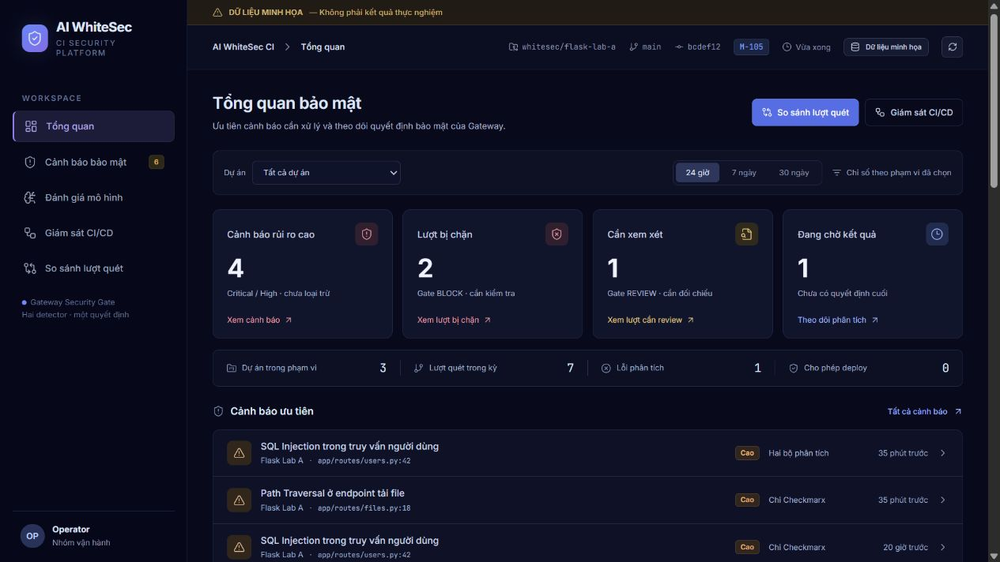
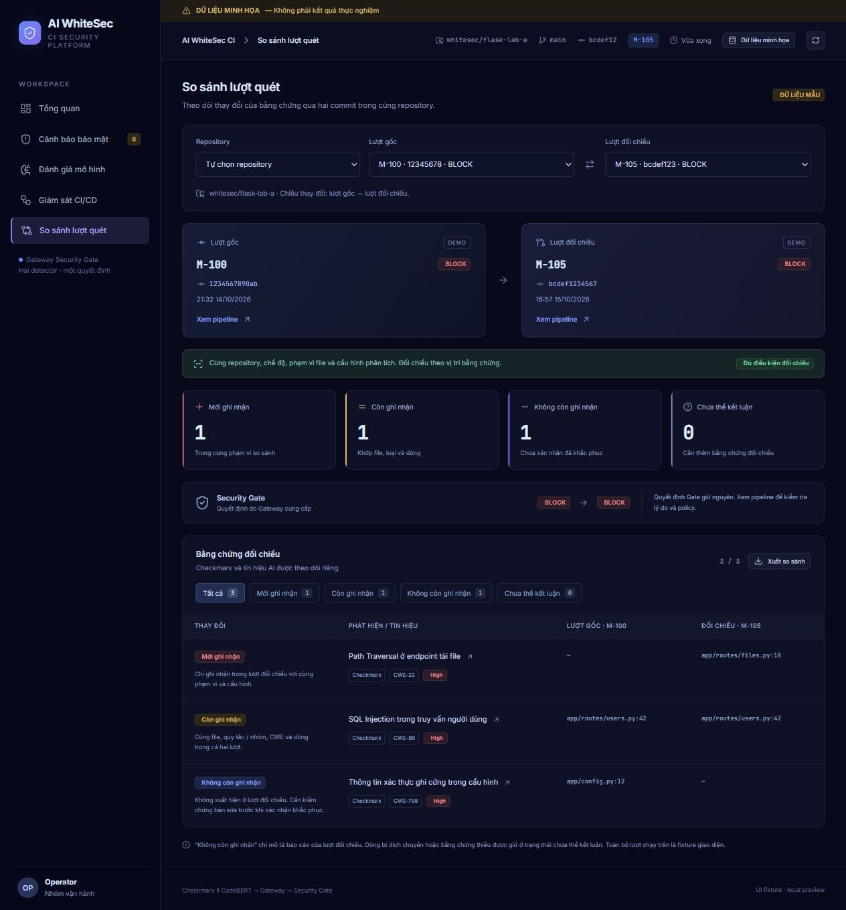

# AI WhiteSec CI

## Dashboard mới — Gateway v2

Dashboard nâng cấp nằm trong **[dashboard/](dashboard/README.md)** và chạy độc lập
với backend ban đầu. Module này phục vụ giao diện cùng Gateway tại
`http://127.0.0.1:8080/dashboard`, với luồng **cùng Git snapshot → Checkmarx và
CodeBERT chạy song song → Gateway hợp nhất → Security Gate quyết định**.
API Gateway v2 (`/v1/runs`) khác API của `backend/`; giao diện mới chưa được nối
với backend ban đầu. Backend cũ và hướng dẫn chạy ở cổng `8000` vẫn được giữ bên
dưới. Chạy từng cấu hình riêng vì hai cấu hình đều dùng cổng model `8001`.

Năm màn hình gồm **Tổng quan**, **Giám sát CI/CD**, **Cảnh báo bảo mật**,
**Đánh giá mô hình** và **So sánh lượt quét**. Bản mới bổ sung các ô tổng quan có
thể mở danh sách tương ứng, lý do Security Gate kèm bằng chứng, cùng bộ lọc và
xuất JSON khi so sánh hai lượt quét. Nhãn **không còn ghi nhận** chỉ mô tả kết quả
đối chiếu, không xác nhận lỗ hổng đã được sửa; khác phạm vi hoặc thiếu bằng chứng
được hiển thị rõ.

Chạy demo trên Windows với Python 3.11:

```powershell
cd dashboard
python -m venv .venv
.\.venv\Scripts\python.exe -m pip install -r requirements.txt
.\scripts\run-local.ps1 -Demo -Python .\.venv\Scripts\python.exe
```

Mở [dashboard local](http://127.0.0.1:8080/dashboard). Dừng bằng
`.\scripts\stop-local.ps1`. Nguồn minh họa trong giao diện và chế độ `-Demo`
của model là hai lựa chọn riêng; demo luôn `allow_deploy=false`. Chưa có
Checkmarx thật hoặc classifier đã được duyệt, và trang đánh giá vẫn chờ held-out
dataset cùng ground truth trước khi báo cáo Precision/Recall/F1. Xem
[hướng dẫn module](dashboard/README.md) để dùng nguồn API local và kiểm tra.





## Pipeline backend ban đầu

The remaining sections describe the original `backend/` stack and its dashboard.

Skeleton for an AI-assisted white-box security testing pipeline. It keeps raw
CodeBERT and Checkmarx findings, correlates them into an explainable combined
view, stores versioned scan runs, and presents the results in a four-screen
Vietnamese dashboard based on the supplied Figma Make design.

The current inference service is intentionally a deterministic mock. It lets
the integration, dashboard, and experiments progress before a fine-tuned
CodeBERT checkpoint is available. Mock predictions are not security findings.

## Components

- `backend`: FastAPI API, PostgreSQL persistence, correlation policy, dashboard.
- `inference`: replaceable CodeBERT inference boundary with a mock predictor.
- `pipeline`: Python code extraction, SARIF adapter, and CI orchestrator.
- `experiments`: dependency-free metric calculator for reproducible evaluation.
- `examples`: sample SARIF and ground-truth files for smoke testing.

## Dashboard screens

- **Tổng quan**: KPI, project catalog, incidents, data-source health, recent
  runs, and trend charts.
- **Cảnh báo bảo mật**: filterable findings, CodeBERT/Checkmarx evidence,
  verification controls, and source snippets.
- **Đánh giá mô hình**: benchmark prerequisites and an intentionally empty
  metric table until a held-out dataset and ground truth are available.
- **Giám sát CI/CD**: project/run filters, traceability breadcrumb, interactive
  task graph, events, Security Gate decision, findings, incidents, thesis
  phases, and audit trail.

The amber banner is intentional: content marked as demonstration data must not
be copied into the thesis as an experimental result. The top bar also reports
whether the local API is connected and how many backend runs are available.

## Quick start with Docker

1. Copy `.env.example` to `.env` and change the database password.
2. Start the stack:

   ```powershell
   docker compose up --build
   ```

3. Open `http://localhost:8000`.
4. Create a demonstration scan:

   ```powershell
   Invoke-RestMethod -Method Post http://localhost:8000/api/v1/demo/seed
   ```

API documentation is available at `http://localhost:8000/docs`. The inference
API documentation is available at `http://localhost:8001/docs`.

## Instant dashboard preview without Docker

If Docker and FastAPI are not installed, run the dependency-free preview:

```powershell
python scripts/dev_server.py --seed
```

Then open `http://localhost:8000`. This preview serves the real dashboard with
in-memory demonstration data. It does not replace PostgreSQL, CodeBERT, or the
production FastAPI endpoints.

## Run a pipeline smoke test

With the Docker stack running:

```powershell
python pipeline/run_pipeline.py `
  --root . `
  --repository demo/ai-whitesec `
  --commit-sha local-smoke-test `
  --sarif examples/cx_result.sarif `
  --output artifacts/smoke-result.json
```

The command extracts Python functions, asks the inference service for mock
predictions, imports the sample Checkmarx SARIF, sends both raw result sets to
the backend, and creates the combined view.

## Replacing the mock with CodeBERT

Implement `CodeBertPredictor` in `inference/app/predictor.py` and select it with
`MODEL_MODE=codebert`. The implementation must load the tokenizer, checkpoint,
label map, thresholds, and model metadata from the same versioned artifact.
Do not change the HTTP response contract; the backend and dashboard should not
need to know how the prediction was produced.

The current pilot supports `CWE-22`, `CWE-78`, `CWE-79`, `CWE-89`, and
`CWE-287`. `CWE-798` must remain unsupported until a separately validated model
artifact includes that class.

## Evaluation rule

Keep the held-out test set closed while choosing thresholds and the correlation
policy. Aggregate chunk predictions by `parent_sample_id` before reporting model
metrics so that long functions do not count as multiple vulnerabilities.

See `docs/architecture.md` and `docs/data-contract.md` for the design decisions.

## Run the metric smoke test

```powershell
python experiments/evaluate.py examples/evaluation_predictions.jsonl `
  --aggregate-parent `
  --output artifacts/example-metrics.json
```
