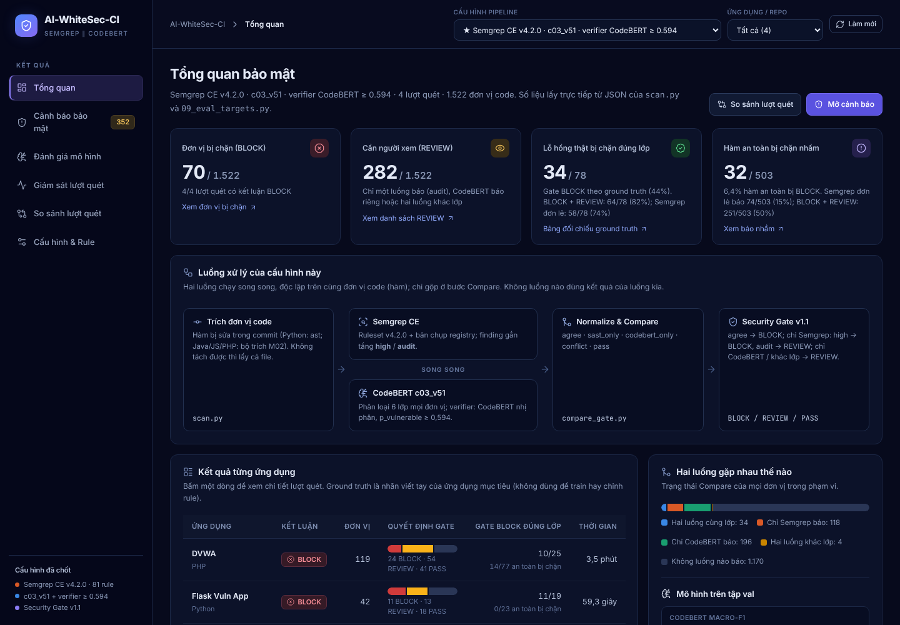
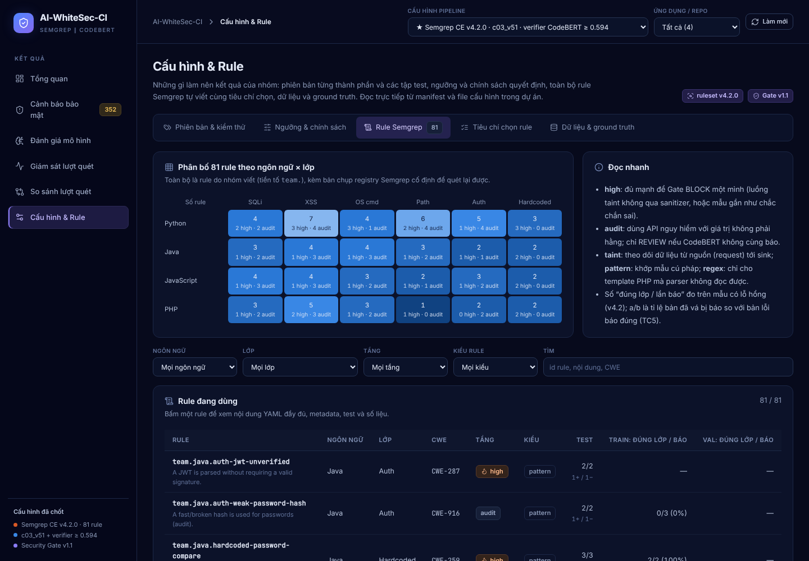

# AI-WhiteSec-CI — Dashboard kết quả

Đây là dashboard của đồ án **AI-WhiteSec-CI** (FCA26IA18). Hệ thống phát hiện 6 lớp lỗ hổng (SQL Injection, XSS, OS Command Injection, Path Traversal, xác thực yếu, thông tin xác thực gắn cứng) trên code Python, Java, JavaScript và PHP. Hai luồng chạy song song, độc lập trên cùng một đơn vị code:

```
                 ┌─ Semgrep CE (ruleset v4.2.0 của nhóm, tầng high/audit) ─┐
 commit → hàm ──┤                                                          ├─→ Compare → Security Gate → BLOCK / REVIEW / PASS
                 └─ CodeBERT 6 lớp (C03) + verifier p_vulnerable ≥ 0,594 ──┘
```

Dashboard chỉ hiển thị **kết quả thực nghiệm thật** của nhóm, không có dữ liệu minh họa. Repo kèm sẵn một **bản chụp kết quả**, nên clone về là chạy được ngay.



## Chạy

Cần Python 3.10 trở lên. Không cần cài thêm thư viện, không cần Node hay internet.

```
python dashboard/server.py
```

Trình duyệt sẽ mở `http://127.0.0.1:8765/`. Trên Windows có thể nhấp đúp `run_dashboard.bat`. Server chỉ nghe trên `127.0.0.1` và chỉ đọc file.

## Sáu màn hình

| Màn hình | Nội dung |
|---|---|
| **Tổng quan** | Số đơn vị BLOCK / REVIEW; số lỗ hổng thật bị chặn đúng lớp và số hàm an toàn bị chặn nhầm (theo ground truth của 4 ứng dụng mục tiêu); luồng xử lý; kết quả từng ứng dụng; cảnh báo ưu tiên |
| **Cảnh báo bảo mật** | Từng đơn vị bị cảnh báo, kèm: lý do Gate (quy tắc policy đã áp dụng), finding Semgrep, xác suất 6 lớp của CodeBERT, p_vulnerable so với ngưỡng, CWE/OWASP, gợi ý khắc phục, nhãn ground truth (đúng lớp / sai lớp / báo nhầm / bỏ sót). Xuất được CSV |
| **Đánh giá mô hình** | CodeBERT 6 lớp (macro-F1 0,735, ma trận nhầm lẫn, ngôn ngữ × lớp), verifier (ROC-AUC 0,850), Security Gate trên val cặp trước/sau vá, 4 ứng dụng mục tiêu, ruleset Semgrep, so sánh trước/sau fine-tune (C06) |
| **Giám sát lượt quét** | Từng lần chạy `scan.py`: cấu hình, SHA-256 ruleset, thời gian từng luồng (song song so với nối tiếp), quyết định Gate |
| **So sánh lượt quét** | Hai lượt của cùng một ứng dụng (ví dụ ruleset v4.1 → v4.2): đơn vị bắt thêm, bỏ sót, bớt báo nhầm |
| **Cấu hình & Rule** | Phiên bản (công cụ, ruleset, mô hình, dữ liệu, các tập test và trạng thái, 270 test của rule, unit test); các ngưỡng và cách chọn; chính sách Gate; **toàn bộ 81 rule Semgrep của nhóm** (nội dung YAML, metadata, test, số liệu train/val) và 5 rule đã tắt kèm lý do; tiêu chí chọn rule TC1–TC8; thành phần dữ liệu, ánh xạ CWE, ground truth viết tay |



Ảnh khác: [Cảnh báo](docs/screenshots/canh-bao.png) · [Security Gate trên val](docs/screenshots/danh-gia-gate.png) · [So sánh lượt quét](docs/screenshots/so-sanh.png)

## Bản chụp kết quả kèm theo

| Thư mục | Nội dung |
|---|---|
| `reports/targets/` | JSON của `scan.py` và `09_eval_targets.py` trên 4 ứng dụng mục tiêu (Flask Vuln App, DVWA, WebGoat, Juice Shop), cho 4 cấu hình: D05, C03 (có Bandit), Semgrep v4.1, Semgrep v4.2 (hiện tại) |
| `reports/` | Đánh giá trên val: Gate (`gate_eval_val_v42.json`), J01 val, rule metrics, C06, lưới C01; số mẫu dữ liệu đã đếm (`dataset_summary.json`) |
| `models/` | `pipeline_config.json`, `gate_config.json`, `run_info.json` của C03 và verifier (**không có trọng số mô hình**) |
| `security-config/semgrep/` | Ruleset v4.2.0 (`semgrep.yml`), manifest, kết quả 270 test, rule đã tắt, tiêu chí chọn rule |
| `targets/*/ground_truth.json` | Ground truth viết tay của 4 ứng dụng (không kèm mã nguồn ứng dụng, nên phần “Mã nguồn” trong màn Cảnh báo sẽ trống) |
| `data_versions/*/manifest.json` | Phiên bản và SHA-256 của dữ liệu (**không kèm dữ liệu train/val/test**) |

Tập test chính (`six_class_v5_1_e03`, 746 mẫu) vẫn đang **đóng băng**: mọi ngưỡng, rule và cấu hình đều chọn trên train/val. Thời điểm gốc của các file nằm trong `reports/snapshot_times.json`.

## Dùng với dự án đầy đủ

Chép thư mục `dashboard/`, `run_dashboard.bat` và `tests/test_dashboard.py` vào thư mục `main/` của dự án. Dashboard sẽ đọc trực tiếp kết quả mới nhất, có thêm mã nguồn của các ứng dụng mục tiêu và tự đếm dữ liệu từ CSV. Muốn hiển thị lượt quét của một commit hoặc từ CI, đặt JSON của `scan.py` vào `reports/scans/`.

## Kiểm thử

```
python -m unittest tests.test_dashboard -v
```

GitHub Actions (`.github/workflows/dashboard-tests.yml`) chạy bộ test này với Python 3.10–3.12 ở mỗi lần push. Chi tiết kỹ thuật và phần đã lược bỏ so với bản dashboard trước (Checkmarx, Gateway FastAPI, PostgreSQL/Docker Compose, API key, dữ liệu minh họa) nằm trong [dashboard/README.md](dashboard/README.md).
