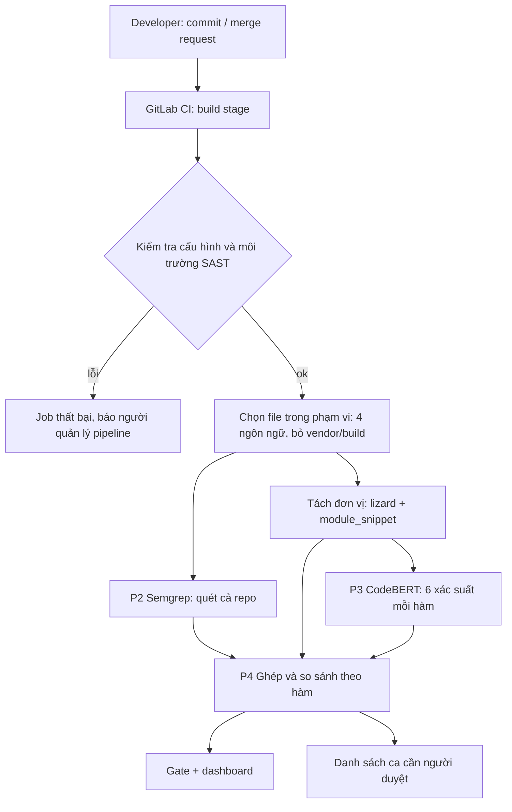

# Semgrep tool – Tài liệu cho người viết rule (KLTN)

Phiên bản tài liệu: 1.2 · 2026-10-25 · Ruleset hiện tại: **v4.2.0 (81 rule)** · Semgrep **1.181.0**

Nhãn trạng thái dùng trong tài liệu:
- **[Chốt]** đã được trưởng nhóm duyệt.
- **[Mặc định]** đang áp dụng, chờ trưởng nhóm xác nhận lần cuối.
- **[Mở]** chưa quyết, không tự quyết, hỏi trưởng nhóm.

Mọi đường dẫn tính từ thư mục gốc dự án `main/`.

---

## 0. Mười điều bắt buộc

1. **Không dùng Bandit**, kể cả làm đối chứng. Phía SAST chỉ có Semgrep. [Chốt]
2. Chỉnh rule bằng **train**, đo bằng **val**. Không đọc, không quét **test**; không đọc kết quả hay báo cáo review của CodeBERT trên test. [Chốt]
3. Không dùng **4 ứng dụng mục tiêu** để chỉnh rule; chỉ dùng cho đánh giá cuối. [Mặc định]
4. Tên lớp và danh sách CWE chỉ lấy từ `docs/taxonomy.yml`. [Chốt]
5. Semgrep đúng **1.181.0**. Sau mọi thay đổi rule: `ruleset.py all` rồi `ruleset.py verify`. [Chốt]
6. Đo **chính thức** trên dataset **v2.2** (CodeBERT đã đóng băng trên v2.2). Trước mọi việc: **kiểm tra chồng lấn** (mục 8.4). [Chốt]
7. Chỉ viết rule mới khi có **≥ 3 mẫu train** bị sót cùng một dạng API/mẫu code. [Chốt]
8. Ngưỡng giữ rule: **high ≥ 0,80**, **audit ≥ 0,50**, chỉ kết luận khi rule có **≥ 5 lần báo**. [Chốt]
9. Không xóa rule; rule bị tắt chuyển vào `rules_disabled/` kèm lý do. [Chốt]
10. **Không bao giờ dùng kết quả Semgrep làm nhãn** (kể cả nhãn cho việc học lại CodeBERT). Không chắc thì hỏi, không đoán. [Chốt]

---

## 1. Vai trò của Semgrep trong khóa luận [Chốt]

- **CodeBERT là mô hình chính**: dự đoán ở mức hàm, cho 6 xác suất (một cho mỗi nhóm), mỗi nhóm một ngưỡng, **không trả vị trí dòng**. Hàm không có nhóm nào vượt ngưỡng thì qua (không có nhãn thứ 7).
- **Semgrep hỗ trợ CodeBERT** bằng ba việc:
  1. Cho **vị trí dòng** và **lời giải thích** (rule, CWE, thông điệp) mà CodeBERT không có.
  2. Cho một **ý kiến độc lập** để đối chiếu kết quả hai bên.
  3. Cung cấp các ca **Semgrep bắt, CodeBERT sót** để **người duyệt** rồi đưa vào học lại.
- Hệ quả cho người viết rule:
  - Ưu tiên tầng `high` **chính xác** hơn là chạy theo tổng recall.
  - **Không viết rule theo từng lỗi cụ thể của CodeBERT.** Rule viết theo mẫu API và khoảng trống của chính Semgrep. Kết quả CodeBERT (chỉ trên val) chỉ dùng để xếp thứ tự ô nào làm trước.
- Hội đồng có thể hỏi "sao không bỏ một công cụ". Câu trả lời phải là số liệu: bảng giao nhau trên test (mục 8, R5).

---

## 2. Hạ tầng và vị trí của Semgrep

### 2.1. Luồng tổng (đã cập nhật so với sơ đồ P1–P3)



Những điểm khác so với sơ đồ P1–P3 hiện có:

| Sơ đồ | Điểm cần sửa |
|---|---|
| P1 | **[Chốt]** Repo đặt trên GitLab, dùng **GitLab CI** (`.gitlab-ci.yml` ở thư mục gốc repo). File `ci/github-actions-scan.yml` là bản cũ: chuyển vào thư mục lưu trữ, không dùng. |
| P1 | Không dùng template SAST có sẵn của GitLab; job Semgrep dùng bộ rule `team.*` của dự án. |
| P1 | **[Mở]** Runner chạy job (máy riêng của nhóm hay runner dùng chung của GitLab) và nơi lưu file model. |
| P1 | Nút "SAST ?" (kiểm tra lỗi cấu hình và môi trường) đổi tên thành **"Kiểm tra cấu hình và môi trường SAST"**: Semgrep 1.181.0, `ruleset.py verify`, `taxonomy.yml`, model, file ngưỡng, phiên bản lizard. Nhánh lỗi: **job thất bại, báo người quản lý pipeline**, không quay về bước sửa code ứng dụng. |
| P1 | Thêm bước **chọn file trong phạm vi** *trước* khi tách hai nhánh, để Semgrep và CodeBERT nhìn **cùng một tập file**. |
| P1 | **Function list** phải đi tới cả P4 (để ghép dòng Semgrep vào hàm), không chỉ P3. |
| P2 | "Rule valid?" là `ruleset.py verify` + kiểm tra phiên bản Semgrep. |
| P2 | Lỗi parse **không dừng quét**, nhưng phải ghi **trạng thái parse của từng file** vào kết quả (mục 2.3). |
| P2 | Hậu xử lý: lớp lấy từ `metadata.vuln_class` và đối chiếu `taxonomy.yml`; thêm `confidence`; bỏ finding ngoài 6 lớp. |
| P2, P3 | Bước cuối P2 tên "Compare", P3 tên "Correlation": thống nhất một tên (đề xuất: **P4 Ghép và so sánh**). |
| P4 | Chưa có sơ đồ. Cần vẽ: ghép theo hàm, 3 nhóm so sánh, gate, danh sách người duyệt. |

Sơ đồ P3 (CodeBERT) không thuộc phần việc của người viết rule; các điểm cần sửa ở P3 do trưởng nhóm trao đổi riêng với phía CodeBERT.

### 2.2. P2 – Semgrep: đầu vào, xử lý, đầu ra

| Bước | Việc | Ghi chú |
|---|---|---|
| 1. Đầu vào | Repo đã lọc phạm vi; `security-config/semgrep/semgrep.yml` + `ruleset-manifest.json`; danh sách loại trừ chung | Quét **cả repo**, không chỉ file thay đổi [Chốt] |
| 2. Kiểm tra | `semgrep --version` = 1.181.0; `ruleset.py verify` (SHA-256 bundle khớp manifest) | Sai thì dừng, báo lỗi cấu hình |
| 3. Quét | `semgrep scan --metrics=off --config security-config/semgrep/semgrep.yml --json -o semgrep.json <repo>` | Không dùng `--config auto` hay `p/...` |
| 4. Trạng thái parse | Mỗi file: `ok`, `partial` hoặc `failed` | "Không báo" khác "không phân tích được" |
| 5. Hậu xử lý | Lấy lớp từ `metadata.vuln_class`; kiểm tra CWE thuộc lớp đó theo `taxonomy.yml` (lệch thì báo lỗi); bỏ finding ngoài 6 lớp; gắn tầng `high`/`audit`; gộp finding trùng (cùng rule, cùng file, cùng dòng) | |
| 6. Đầu ra | `semgrep-results.json` → Findings DB → P4 | Định dạng ở mục 2.3 |

**Danh sách loại trừ dùng chung với phía CodeBERT** (đặt trong `.semgrepignore`): `node_modules/`, `vendor/`, `dist/`, `build/`, `*.min.js`. Phía CodeBERT còn loại file có dòng trung bình > 300 ký tự và hàm > 100 KB; nếu Semgrep không loại được bằng đường dẫn thì bước hậu xử lý phải bỏ finding thuộc các file/hàm đó, để hai bên cùng phạm vi. [Mặc định]

### 2.3. Định dạng `semgrep-results.json` [Mặc định]

```json
{
  "run": {
    "semgrep_version": "1.181.0",
    "ruleset_version": "4.2.0",
    "bundle_sha256": "<sha256>",
    "taxonomy_version": "0.3.0",
    "repo": "<tên repo>",
    "commit": "<git sha>",
    "scanned_at": "2026-10-25T10:00:00+07:00",
    "excludes": ["node_modules/", "vendor/", "dist/", "build/", "*.min.js"]
  },
  "files": [
    {"path": "app/views.py", "language": "python", "parse_status": "ok"}
  ],
  "findings": [
    {
      "file": "app/views.py",
      "language": "python",
      "rule_id": "team.py.sqli-taint",
      "class": "SQL_INJECTION",
      "cwes": ["CWE-89"],
      "confidence": "high",
      "semgrep_severity": "ERROR",
      "impact_severity": "critical",
      "start_line": 42,
      "end_line": 42,
      "message": "Request data reaches an SQL query string."
    }
  ]
}
```

P4 sẽ thêm cho mỗi finding: đơn vị chứa nó (`function` hoặc `module_snippet`) và `line_visible_to_codebert`.

### 2.4. P4 – Ghép với CodeBERT (để người viết rule hiểu kết quả sẽ được dùng thế nào)

- **Chế độ dataset**: mỗi mẫu quét riêng, finding thuộc chính mẫu đó. Số dòng của mẫu theo bản file **trước khi sửa**.
- **Chế độ repo**: tách đơn vị bằng **đúng bộ tách của phía CodeBERT** (lizard, `module_snippet` ±5 dòng cho nhóm Hardcoded, cắt 512 token). Finding thuộc đơn vị khi cùng file và `start_line ≤ line ≤ end_line`; hàm lồng thì lấy hàm trong cùng.
- **`line_visible_to_codebert`**: dòng finding có nằm trong 512 token đầu mà CodeBERT nhìn thấy không. Tính bằng **đúng code tokenize/cắt của phía CodeBERT** (tokenizer `microsoft/codebert-base`). Không tự viết lại.
- **Bảng so sánh luôn tách 3 nhóm**: (1) đơn vị chưa bị cắt; (2) bị cắt nhưng finding nằm trong 512 token đầu; (3) bị cắt và finding nằm ngoài. Nhóm (3) chỉ phản ánh việc cắt, **không** phải bằng chứng hai công cụ bổ trợ nhau, và **không** đưa vào học lại.
- **Gate**: luật gộp hiện chỉ là bản nháp trong `taxonomy.yml`; trọng số và công thức rủi ro chốt ở Phase 6. Người viết rule không sửa gate.

---

## 3. Chuẩn chung (`docs/taxonomy.yml`)

| Lớp | CWE | Mức nghiêm trọng mặc định |
|---|---|---|
| SQL_INJECTION | 89 | critical |
| XSS | 79 | medium |
| OS_COMMAND_INJECTION | 78, 77, 88 | critical |
| PATH_TRAVERSAL | 22, 23, 36 | high |
| INSECURE_AUTHENTICATION | 287, 306, 307 (+916 theo metadata rule, chờ xác nhận) | high |
| HARDCODED_CREDENTIALS | 798, 259, 321 | high |

- **[Chốt]** Tên lớp Auth là **`INSECURE_AUTHENTICATION`** (theo vector nhãn của model). Tên cũ `AUTHENTICATION_WEAKNESS` chỉ còn trong báo cáo cũ. Rule ghi `vuln_class: INSECURE_AUTHENTICATION`; đổi tên ở rule cũ làm trong **một đợt riêng** (mục 9).
- **[Mở]** CWE-916 (băm mật khẩu yếu): đối chiếu với bảng ánh xạ CWE → nhãn khi dựng dataset v2.2 (DATA_CARD hoặc script gán nhãn) rồi chốt.
- Ngôn ngữ: Python, Java, JavaScript, PHP (theo đuôi `.py`, `.java`, `.js/.jsx/.mjs/.cjs`, `.php`).
- Mẫu không thuộc 6 nhóm gọi là **"Mẫu âm (không thuộc 6 nhóm)"**. Không dùng tên `ALL_ZERO`.
- Đơn vị mẫu: `function` (thân hàm theo lizard) hoặc `module_snippet` (chỉ nhóm Hardcoded, nguồn CredData: dòng credential ±5 dòng).

---

## 4. Semgrep phân tích code thế nào

Semgrep parse từng file thành cây cú pháp (AST), rồi so từng rule với cây đó. Rule nào khớp thì sinh một finding. Các rule độc lập với nhau.

| Kiểu | Hoạt động | Dùng khi |
|---|---|---|
| `pattern`, `pattern-either`, `patterns` | Khớp hình dạng đoạn code (`$X` là biến đại diện, `...` là bất kỳ) | Mẫu gần như chắc chắn sai, hoặc API nguy hiểm với giá trị động |
| `mode: taint` | Theo dõi dữ liệu từ **source** tới **sink**; dừng khi qua **sanitizer** | Có đường đi dữ liệu rõ |
| `pattern-regex` | So chuỗi văn bản thô | Chỉ khi parser không đọc được file (ví dụ template PHP bị `PARSE_ERROR`) |

Giới hạn cần nhớ:
- Rule chỉ thấy **cú pháp và luồng dữ liệu**. Lỗi logic (phân quyền sai, SAML, luồng đăng nhập) không có sink chung, để CodeBERT xử lý.
- Taint ở bản Community được hiểu là **chỉ theo dõi trong một hàm** (cần kiểm tra lại với tài liệu Semgrep 1.181.0). Mẫu là đoạn hàm cắt ra càng bất lợi.
- Đoạn hàm cắt ra có thể **không parse được** (Java ngoài class, PHP thiếu `<?php`). Recall thấp do parse không phải lý do để viết thêm rule; đo tỉ lệ parse trước.

---

## 5. Tiêu chí viết rule

Chi tiết từng tiêu chí: `security-config/semgrep/TIEU_CHI_CHON_RULE.md` (TC1–TC8). Mục này là bản tóm tắt bắt buộc tuân theo.

### 5.1. Khi nào viết rule mới (TC2)

Viết khi **đủ cả ba**:
1. Có **≥ 3 mẫu train** thuộc 6 lớp bị sót, **cùng một API hoặc mẫu code**.
2. Không rule `team.*` nào bắt được, và không rule Registry phù hợp (mục 7).
3. Mẫu đó parse được, hoặc có lý do rõ để dùng regex.

**Không viết** khi:
- Chỉ có 1–2 mẫu lẻ.
- Lỗi là logic, không có sink chung.
- Lý do duy nhất là CodeBERT đoán sai ca đó.
- Nguồn bằng chứng là val, test hay 4 ứng dụng.

### 5.2. Chọn kiểu rule và tầng (TC7, TC8)

| Tình huống | Kiểu | `confidence` | `severity` (Semgrep) |
|---|---|---|---|
| Có source → sink rõ, không qua sanitizer | `mode: taint` | high | ERROR |
| Mẫu gần như chắc chắn sai (tắt verify JWT, so mật khẩu với chuỗi hằng) | `pattern` | high | ERROR |
| API nguy hiểm nhận giá trị không phải hằng | `pattern` + `pattern-not` hằng chuỗi | audit | WARNING |
| Parser không đọc được file | `pattern-regex` + `paths.include` | thường là audit | WARNING |

### 5.3. Ba trường mức độ – đặt thế nào

| Trường | Giá trị | Ý nghĩa | Quy tắc đặt |
|---|---|---|---|
| `severity` (Semgrep) | ERROR / WARNING / INFO | Mức hiển thị của công cụ | **Chỉ suy từ `confidence`**: high → ERROR, audit → WARNING |
| `metadata.confidence` | high / audit | Độ tin cậy của finding | Theo bảng 5.2 và ngưỡng 5.4 |
| `metadata.severity` | critical / high / medium / low | Mức nghiêm trọng nếu đúng là lỗi | **Chỉ suy từ lớp**, theo bảng mục 3 |

Hiện có rule lệch quy tắc này (ví dụ `team.sql-injection`, `team.hardcoded-credentials`: high nhưng `severity: WARNING`). Sửa cho đúng khi chạm vào rule đó, tăng `rule_version`. Thang mức nghiêm trọng cuối cùng chốt ở Phase 6; bảng trên là quy ước tạm.

### 5.4. Ngưỡng giữ rule (TC4, TC5)

| Tiêu chí | high | audit |
|---|---|---|
| Tỉ lệ đúng lớp trên **train** (cần ≥ 5 lần báo) | ≥ 0,80 | ≥ 0,50 |
| Tỉ lệ đúng lớp trên **val** (khi val ≥ 5 lần báo) | ≥ 0,80 | ≥ 0,50 |
| TC5 – cặp lỗi/vá | theo ngưỡng hiện hành trong `TIEU_CHI_CHON_RULE.md` | không báo bản vá nhiều hơn bản lỗi |
| Tỉ lệ báo nhầm trên mẫu âm (v2.2) | ghi số, ngưỡng **[Mở]** | ghi số, ngưỡng **[Mở]** |

Quy tắc xử lý:
- Rule có **< 5 lần báo** thì ghi "chưa đủ dữ liệu", **không** kết luận và không tắt.
- Rule `high` không đạt: **hạ xuống `audit`** trước; chỉ tắt khi rớt cả ngưỡng `audit`. Mọi ngoại lệ ghi lý do.
- **Không đổi ngưỡng TC5.** TC5 hiện so cả file nên yếu khi bản vá chỉ đổi vài dòng. Hướng sửa là đo theo **dòng bị sửa**; chỉ làm khi trưởng nhóm duyệt. [Mở]
- Rule taint báo nhiều bản đã vá: **rà tay ~10 ca trước**, vì nguyên nhân thường là thiếu sanitizer (ví dụ hàm escape riêng của framework), sửa sanitizer thay vì hạ tầng.

### 5.5. Định nghĩa chỉ số (ghi đúng tên trong báo cáo)

| Tên | Công thức | Ghi chú |
|---|---|---|
| Recall mẫu | mẫu dương có ≥ 1 finding đúng lớp / tổng mẫu dương | Báo riêng cho high và cho high+audit |
| Tỉ lệ đúng lớp | finding đúng lớp / tổng finding trên mẫu dương | **Không phải precision**: không đo báo nhầm trên code an toàn |
| Tỉ lệ báo nhầm trên mẫu âm | mẫu âm có ≥ 1 finding / tổng mẫu âm | Kiểm tra trong DATA_CARD v2.2 rằng có mẫu âm |
| Tỉ lệ parse | file `ok` / tổng file, theo ngôn ngữ | Đo trước khi diễn giải recall |

---

## 6. Cách viết rule (quy trình)

1. **Tìm khoảng trống** trên train: bảng 24 ô (ngôn ngữ × lớp), danh sách mẫu bị sót, gom theo API/sink.
2. **Xác định source, sink, sanitizer.** Quy ước nhóm: hàm tên bắt đầu `validate`, `sanitize`, `escape`, `clean`, `is_valid` là sanitizer và **phải trả về giá trị đã làm sạch** (`host = validate_host(request.args["host"])`).
3. **Chọn kiểu và tầng** theo mục 5.2.
4. **Viết rule** vào `security-config/semgrep/rules/<ngôn ngữ>/<lớp>.yml`, đủ metadata (khuôn mẫu bên dưới).
5. **Viết test**: `tests/positive/<ngôn ngữ>/<lớp>.*` với chú thích `ruleid: <id>` ngay trước dòng phải báo; `tests/negative/<ngôn ngữ>/<lớp>.*` với `ok: <id>` trước dòng không được báo. Mỗi rule ≥ 1 positive và ≥ 1 negative, viết theo **mẫu tổng quát**, không chép nguyên mẫu dataset.
6. **Chạy** `python security-config/semgrep/tools/ruleset.py all` (kiểm metadata → sinh bundle → chạy test → cập nhật manifest), rồi `ruleset.py verify`.
7. **Đo** trên train và val theo mục 5.4, 5.5.
8. **Ghi nhận** vào báo cáo: rule bắt ca nào trên train, kết quả trên val, quyết định và lý do.

Đặt tên rule:
- Rule mới: `team.<py|java|js|php>.<tên-ngắn>`; rule tầng audit: `team.<ngôn ngữ>.audit.<tên-ngắn>`.
- Một số rule Python cũ không có tiền tố ngôn ngữ (`team.sql-injection`, `team.audit.sql-api`). Giữ nguyên id cũ để không vỡ so sánh giữa các phiên bản.

Phiên bản:
- Sửa rule cũ: tăng `rule_version` (dạng `1.0.0` → `1.1.0`).
- Phát hành bộ mới: tăng `ruleset_version` (bộ tiếp theo: `4.3.0`).
- Trước khi sửa lớn: lưu bản cũ vào `security-config/semgrep/archive/`.

Khuôn mẫu rule taint:

```yaml
rules:
- id: team.py.<ten-rule>
  languages: [python]
  severity: ERROR                      # high → ERROR, audit → WARNING
  message: <Mô tả ngắn: rule phát hiện gì, vì sao nguy hiểm>
  metadata:
    cwe: CWE-78
    owasp: A03:2021
    vuln_class: OS_COMMAND_INJECTION   # đúng tên trong taxonomy.yml
    confidence: high                   # high | audit
    severity: critical                 # theo lớp, bảng mục 3
    scope: Python; Flask, Django, FastAPI
    rule_version: 1.0.0
    ruleset_version: 4.3.0
  mode: taint
  pattern-sources:
  - pattern: request.args
  pattern-sinks:
  - pattern: os.system(...)
  pattern-sanitizers:
  - pattern: shlex.quote(...)
```

Khuôn mẫu rule audit (API nguy hiểm với giá trị động):

```yaml
rules:
- id: team.py.audit.<ten-rule>
  languages: [python]
  severity: WARNING
  message: <API> nhận giá trị không phải hằng; cần rà nguồn dữ liệu.
  metadata:
    cwe: CWE-78
    owasp: A03:2021
    vuln_class: OS_COMMAND_INJECTION
    confidence: audit
    severity: critical
    scope: Python; subprocess
    rule_version: 1.0.0
    ruleset_version: 4.3.0
  patterns:
  - pattern: subprocess.Popen($CMD, ...)
  - pattern-not: subprocess.Popen("...", ...)
```

Tắt rule:
- Chuyển nguyên khối rule sang `security-config/semgrep/rules_disabled/`, chạy lại `ruleset.py all`.
- Ghi vào báo cáo: số đo trên train (và val nếu ≥ 5 lần báo), tiêu chí bị rớt, tác động tới recall của ô.

---

## 7. Cách lấy rule có sẵn (Semgrep Registry)

Registry dùng cho hai việc: (a) **nguồn ý tưởng** để viết lại rule cho các ô còn thiếu; (b) **cấu hình đối chứng** trong chương đánh giá. Rule Registry **không** đưa thẳng vào bộ `team.*` và **không** đưa vào gate.

### 7.1. Sáu tiêu chí nhận một rule Registry (phải đạt cả 6)

1. Thuộc 1 trong 6 lớp và đúng 1 trong 4 ngôn ngữ. **Tự đọc nội dung rule để đối chiếu CWE**, không tin nhãn metadata.
2. Chạy được trên Semgrep Community 1.181.0 (không cần bản Pro, không cần phân tích liên file).
3. Không trùng chức năng với rule `team.*` đã có (so source/sink/pattern).
4. Bắt thêm **mẫu train** mà bộ `team.*` hiện tại bỏ sót.
5. Đạt ngưỡng ở mục 5.4 trên train (≥ 5 lần báo).
6. Giấy phép cho phép dùng trong nghiên cứu; ghim theo commit. **Phải đọc file LICENSE thực tế** của repo rule, không dựa vào trí nhớ.

### 7.2. Quy trình

1. Tải repo rule của Semgrep về máy ở **một commit cụ thể**; ghi lại commit SHA. **Không** dùng `--config auto` hay `--config p/<pack>` (tải bản mới mỗi lần nên không tái lập được).
2. Lọc sơ bộ theo tiêu chí 1–3.
3. Chạy **từng rule ứng viên** trên train; đo tiêu chí 4–5.
4. Rule đạt: **viết lại theo chuẩn mục 6** (id `team.*`, đủ metadata, test positive/negative). Không chép nguyên.
5. Ghi mọi rule đã xét vào `security-config/semgrep/reports/registry_review.csv`.

Cột của `registry_review.csv`:

```
registry_rule_id, registry_commit, language, class_by_reading, cwe_in_metadata,
community_ok, duplicate_of_team_rule, train_new_tp, train_hits, train_class_rate,
license_ok, decision, reason, team_rule_id_if_adopted
```

### 7.3. Cấu hình đối chứng

- Đóng gói các rule Registry đã ghim (theo commit) thành một bundle riêng, chỉ dùng để **so sánh** trên val và (cuối cùng) test.
- Báo cáo **tách riêng** số của bộ `team.*` và số của bundle Registry. Không gộp chung thành một cột (trước đây cột "SAST_B (custom + registry)" làm không tách được đóng góp của rule tự viết).

---

## 8. Dữ liệu, quy tắc đo và kế hoạch

### 8.1. Dữ liệu

| Phiên bản | Trạng thái | Dùng cho |
|---|---|---|
| "train/val v5" + cặp a01 | Dữ liệu đã dùng để chỉnh v4.2 | **Chưa rõ quan hệ với v2.x** → phải kiểm tra chồng lấn (mục 8.4) |
| v2, v2.1 | Bản trung gian | Không dùng cho số liệu |
| **v2.2** | CodeBERT đóng băng (`v22_sel_e8`); test v2.2 giữ nguyên sha256 | **Đo chính thức**: chỉnh bằng train, đo bằng val; test chỉ quét **một lần** ở R5 |
| v2.3 | Kế hoạch cải thiện nhãn: train/val mới, test = v2.2 nguyên vẹn | Tùy chọn: đo lại trên val v2.3 sau R4 |

- Mỗi báo cáo ghi: phiên bản và sha256 dataset (theo `docs/provenance.md` và DATA_CARD của v2.2), sha256 file split.
- Mọi số liệu cũ (kể cả trong mục 9) đo trên "train/val v5": **đo lại trên v2.2** trước khi dựa vào.
- 36% mẫu v2 vượt 512 token (`over_512 = true`); kiểm tra lại tỉ lệ trên v2.2. Luôn tách nhóm này khi so sánh (mục 2.4).

### 8.2. Kế hoạch (R0–R6)

| Phase | Việc | Đầu ra | Điều kiện xong |
|---|---|---|---|
| R0 | Chuẩn chung | `docs/taxonomy.yml` hết mục TODO | Hai phía cùng đọc một file |
| R1 | Kiểm tra chồng lấn + đo nền | Báo cáo chồng lấn (mục 8.4); bảng 24 ô train/val v2.2, tỉ lệ parse, danh sách FN train | Chồng lấn đã xử lý; bảng chính thức trên v2.2 |
| R2 | Đóng việc dở của v4.2 (mục 9) | Báo cáo v4.2 bằng số thật | Mọi thay đổi có lý do |
| R3 | Registry | `registry_review.csv`, bundle đối chứng đã ghim | Đủ 6 tiêu chí cho mỗi rule đã xét |
| R4 | Rule mới cho 2–3 ô thiếu nhiều nhất | Rule + test + số đo | Đạt mục 5 |
| R5 | Đóng băng + đánh giá cuối | Chạy **một lần** trên test, 4 ứng dụng, mức repo; bảng giao nhau theo lớp × 3 nhóm | Bundle khóa SHA-256, không sửa rule sau đó |
| R6 | Danh sách học lại | Ca Semgrep bắt, CodeBERT sót, **chỉ từ train/val**, đã người duyệt | Có người duyệt, ngày, kết luận |

Rule đổi sau R5 thì phải chạy lại R5.

### 8.3. Báo cáo

- Lưu ở `security-config/semgrep/reports/`; tên có phiên bản dataset và ngày (ví dụ `r1_v22_2026-10-26.md` kèm `.csv`).
- Đầu báo cáo: dataset + sha256, sha256 split, phiên bản Semgrep, ruleset version + sha256 bundle, lệnh đã chạy.
- Cuối báo cáo: mục **"Điều chưa chắc chắn"**.

### 8.4. Kiểm tra chồng lấn (làm trước mọi việc ở R1–R4)

Lý do: v4.2 được chỉnh trên "train/val v5" và cặp a01, chưa rõ có trùng với **test v2.2** không. Nếu trùng, một phần quyết định về rule đã "nhìn thấy" test, và số liệu so sánh ở R5 bị lạc quan. Việc này **không cần chờ** phía CodeBERT trả lời câu hỏi về split.

1. Xác định "v5" là dataset nào, nằm ở đâu, sha256 bao nhiêu. Không tìm ra thì dừng và hỏi.
2. Lập tập **mẫu đã dùng để chỉnh rule**: toàn bộ train/val v5 và cặp a01 đã dùng cho 21_rule_metrics.py và 30_rule_pairs_diff.py.
3. So với **test v2.2** theo ba khóa: (a) repo, (b) commit/CVE, (c) sha256 của code đã chuẩn hóa khoảng trắng. Test v2.2 tách theo repo nên khóa repo là quan trọng nhất.
4. Chỉ ghi **số lượng và danh sách khóa trùng**, không mở nội dung mẫu test.
5. Kết quả:
   - Không trùng: ghi vào báo cáo, tiếp tục.
   - Có trùng: liệt kê rule nào được chỉnh từ mẫu trùng; đánh giá lại quyết định đó **chỉ bằng train v2.2**; ở R5 báo cáo thêm kết quả test **khi bỏ các repo trùng**.

---

## 9. Việc còn dở từ v4.2

| Việc | Hướng xử lý |
|---|---|
| `team.php.path-taint` (7/13 = 0,54 trên train v5) | Hạ xuống `audit`. Ghi ngoại lệ: rule vẫn rớt TC5-audit (bản vá 10 > bản lỗi 7) nhưng là rule PHP PATH_TRAVERSAL gần như duy nhất còn lại |
| Đề xuất đổi ngưỡng TC5 | **Không làm** (với 7 rule high đủ mẫu, ngưỡng mới cho kết quả y như ngưỡng cũ) |
| Tắt `team.java.auth-secret-equals`, `team.js.auth-secret-equality` | Giải trình lại: train chỉ có 1 và 3 lần báo (< 5), quyết định đang dựa vào val và 4 ứng dụng |
| `team.php.xss-taint` báo 65 bản vá / 98 bản lỗi (cặp a01) | Rà tay ~10 ca bản vá **thuộc train v2.2**; nghi thiếu sanitizer |
| Bảng tính v4.2 | Thay số ước lượng bằng số thật; sửa nhãn "SAST v4.1" trong báo cáo Gate |
| Ô PHP PATH_TRAVERSAL (6/120 train, 0/24 val v5 sau v4.2) | Đo lại trên v2.2; viết rule hẹp từ FN của **train v2.2** (≥ 3 mẫu cùng dạng) |
| `severity` lệch ở `team.sql-injection`, `team.hardcoded-credentials` | Đổi sang ERROR (cả hai là high), tăng `rule_version`. Kiểm tra trước xem gate hoặc báo cáo có dùng `severity` của Semgrep không |
| Đổi tên `vuln_class` Auth | Một đợt riêng: mọi rule Auth đổi sang `INSECURE_AUTHENTICATION`, tăng `rule_version`; cập nhật `03_run_sast.py` và mọi chỗ so tên lớp; không đổi logic so khớp |

---

## 10. Câu hỏi mở (hỏi trưởng nhóm, không tự quyết)

1. Runner cho GitLab CI: máy riêng của nhóm hay runner dùng chung; file model CodeBERT lưu ở đâu (không đưa vào git).
2. CWE-916 thuộc nhóm nào theo bảng gán nhãn của v2.2.
3. Kết quả kiểm tra chồng lấn (mục 8.4); nếu có trùng, cách xử lý cụ thể.
4. Ngưỡng tỉ lệ báo nhầm trên mẫu âm cho high và audit.
5. Có đổi TC5 sang đo theo dòng bị sửa không.
6. Xác nhận lần cuối: 4 ứng dụng chỉ dùng đánh giá cuối.
